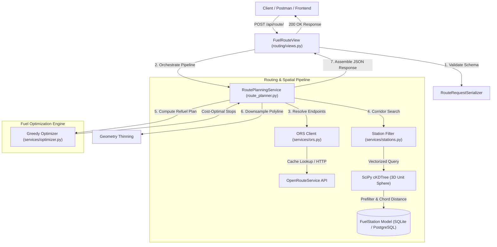

# Fuel Route Optimizer API

A production-grade REST API that calculates driving routes across the contiguous United States, identifies cost-optimal fuel stops along the path (500-mile max vehicle range, 10 MPG consumption), and minimizes total fuel expenditure.

Built with **Django 5.2** & **Django REST Framework**, powered by **OpenRouteService (Directions & Geocoding)** and **SciPy / NumPy (Spatial cKDTree Indexing)**.

---

## Architecture & Data Flow



---

## Key Features

- **Cost-Optimal Greedy Solver ($O(N \log N)$):** Solves the classic Gas Station Refueling Problem:
  - If the destination is reachable on current fuel: buys only the fuel needed to arrive.
  - If a cheaper station is reachable ahead: buys just enough fuel to reach the cheaper station.
  - If current station is the local price minimum: fills the tank to capacity (500 miles) and advances to the cheapest station in range.
- **Sub-Millisecond Spatial Indexing:** Stations are projected onto a 3-D Cartesian unit sphere ($x, y, z$). A 2-D bounding-box prefilter combined with a SciPy `cKDTree` evaluates 6,600+ stations within a 5-mile route corridor in under 5 milliseconds.
- **Zero-Waste Upstream API Budget:**
  - Route directions: exactly 1 call per unique endpoint pair (cached for 24 hours).
  - Geocoding: 1 call per free-text US place name (cached); **0 calls** when coordinates (`"lat,lng"`) are provided.
  - Warm cache: **0 external API calls** with sub-20ms response time.
- **Resilient Network Client:** Thread-safe persistent `requests.Session` with `urllib3` retry adapters, backoff logic, and specific diagnostics for upstream rate limits (HTTP 429).
- **Centralized Exception Handling:** Standardized error contracts (`{"error": "...", "details": ...}`) for validation errors, domain exceptions, upstream outages, and unexpected server failures.
- **Interactive OpenAPI 3.0 / Swagger UI:** Native schema generation and interactive API explorer served at `/api/docs/`.
- **Production Health Checks:** Dedicated `/api/health/` probe verifying database connectivity, station indexing, and cache responsiveness.
- **Dockerized Turnkey Deployment:** Multi-stage `Dockerfile` and `docker-compose.yml` for 1-command startup.

---

## Technology Stack

| Component | Technology | Rationale |
|-----------|------------|-----------|
| **Backend Framework** | Django 5.2 / DRF | Enterprise stability, robust ORM, clean serializer validation, and ecosystem maturity. |
| **Spatial Indexing** | SciPy `cKDTree` & NumPy | Microsecond great-circle distance search without requiring external GIS engines (e.g. PostGIS/GDAL). |
| **Routing & Geocoding** | OpenRouteService REST API | OpenStreetMap-based car routing with precise turn-by-turn road geometry. |
| **Offline Geocoding** | US Census Bureau Gazetteer | Cleaned and normalized 6,620 OPIS truckstops offline without runtime geocoding rate limits. |
| **API Documentation** | `drf-spectacular` (OpenAPI 3.0) | Interactive Swagger and Redoc documentation automatically synced with serializers. |
| **Cross-Origin Security** | `django-cors-headers` | Seamless cross-origin request integration for frontend applications. |

---

## Setup & Installation

### Option 1: Docker (Fastest, Cross-Platform)

```bash
# 1. Clone repository and configure environment
cp .env.example .env
# Edit .env and insert your ORS_API_KEY

# 2. Build and launch container
docker compose up --build

# 3. Access Swagger documentation
open http://localhost:8000/api/docs/
```

### Option 2: Windows (PowerShell / Command Prompt)

```powershell
# 1. Create and activate virtual environment
python -m venv venv
.\venv\Scripts\Activate.ps1       # On Command Prompt: venv\Scripts\activate.bat

# 2. Install dependencies
pip install -r requirements.txt

# 3. Configure environment variables
copy .env.example .env            # Add your OpenRouteService API key to .env

# 4. Migrate database & ingest fuel stations (offline, ~3 seconds)
python manage.py migrate
python manage.py load_fuel_stations

# 5. Run test suite & start development server
python manage.py test routing
python manage.py runserver
```

### Option 3: macOS / Linux

```bash
# 1. Create and activate virtual environment
python3 -m venv venv && source venv/bin/activate

# 2. Install dependencies
pip install -r requirements.txt

# 3. Configure environment variables
cp .env.example .env              # Add your OpenRouteService API key to .env

# 4. Migrate database & load fuel stations
python manage.py migrate
python manage.py load_fuel_stations

# 5. Run test suite & start server
python manage.py test routing
python manage.py runserver 0.0.0.0:8000
```

---

## Environment Variables

| Variable | Default | Purpose |
|----------|---------|---------|
| `ORS_API_KEY` | *(Required)* | OpenRouteService API Key (free at [openrouteservice.org](https://openrouteservice.org/dev/#/signup)). |
| `DJANGO_SECRET_KEY` | `django-insecure-...` | Cryptographic signing secret. Override with a secure string in production. |
| `DEBUG` | `True` | Set to `False` in production to prevent traceback leakage. |
| `ALLOWED_HOSTS` | `*` | Comma-separated list of allowed hostnames/IPs. |
| `CORS_ALLOW_ALL_ORIGINS` | `True` | Enable/disable universal CORS for development. |
| `ROUTE_CACHE_TTL` | `86400` | In-memory cache time-to-live in seconds (24 hours). |
| `ORS_TIMEOUT` | `20` | Upstream HTTP request timeout in seconds. |

---

## API Documentation

### Interactive Swagger UI
Visit `http://127.0.0.1:8000/api/docs/` in your browser for the interactive OpenAPI 3.0 explorer.

### Core Endpoints

#### 1. Plan Route & Optimal Fuel Stops
- **Endpoint:** `POST /api/route/` (or `GET /api/route/?start=...&finish=...`)
- **Headers:** `Content-Type: application/json`
- **Request Body:**
  ```json
  {
    "start": "Los Angeles, CA",
    "finish": "New York, NY"
  }
  ```
  *Note:* Inputs also accept raw coordinates: `{"start": "34.05,-118.24", "finish": "40.71,-74.00"}`.

- **Success Response (`200 OK`):**
  ```json
  {
    "start": { "label": "Los Angeles, CA, USA", "lat": 34.05369, "lon": -118.24276 },
    "finish": { "label": "New York, NY, USA", "lat": 40.71273, "lon": -74.00602 },
    "route": {
      "distance_miles": 2794.7,
      "duration_hours": 41.24,
      "geometry": {
        "type": "LineString",
        "coordinates": [[-118.24276, 34.05369], [-118.23912, 34.05831]]
      }
    },
    "fuel_stops": [
      {
        "order": 1,
        "name": "Maverik #674",
        "address": "123 Highway 15",
        "city": "Baker",
        "state": "CA",
        "lat": 35.26712,
        "lon": -116.07431,
        "mile_marker": 279.7,
        "off_route_miles": 0.45,
        "price_per_gallon": 3.282,
        "gallons_purchased": 27.97,
        "cost": 91.80
      }
    ],
    "starting_tank": {
      "note": "Full tank at departure, valued at the first stop's price.",
      "gallons": 50.0,
      "price_per_gallon": 3.282,
      "cost": 164.10
    },
    "summary": {
      "total_fuel_cost_usd": 864.27,
      "total_gallons": 279.47,
      "number_of_fuel_stops": 14,
      "assumptions": {
        "mpg": 10.0,
        "max_range_miles": 500.0
      }
    },
    "meta": {
      "external_api_calls": 3,
      "candidate_stations_considered": 349,
      "processing_ms": 1150
    }
  }
  ```

#### 2. Service Health Check
- **Endpoint:** `GET /api/health/`
- **Success Response (`200 OK`):**
  ```json
  {
    "status": "healthy",
    "database": "connected",
    "stations_indexed": 6620,
    "cache": "operational"
  }
  ```

---

## Testing & Verification

A comprehensive test suite of **32 automated tests** covers end-to-end integration, domain mathematical invariants, spatial search boundaries, and failure mappings.

```bash
# Run test suite
python manage.py test routing -v 2
```

### Test Suite Structure
- `routing/test_api.py`: Integration tests for HTTP POST & GET, validation errors, non-US rejections, 422 unroutable legs, 502 upstream errors, and Swagger/OpenAPI endpoints.
- `routing/test_optimizer.py`: Mathematical invariant tests for the greedy refueling algorithm (distance / MPG consumption invariant, tie-breaking, leapfrogging, 500-mile max leg constraints).
- `routing/test_services.py`: Unit tests for ORS geocoding, coordinates parsing, haversine vector math, rate-limit mapping (429), and SciPy `cKDTree` spatial corridor filtering.

---

## Postman Collection & Runner

A complete Postman test suite is provided in the `docs/` directory:
- **Collection:** `docs/Fuel_Route_API.postman_collection.json`
- **Environment:** `docs/Fuel_Route_API.postman_environment.json`

### Import & Execution Steps
1. In Postman, click **Import** and select both files from `docs/`.
2. Select the **Fuel Route API - Local Environment** in the top-right environment selector.
3. Open the **Collection Runner** and run the entire collection.
4. All test assertions (status codes, JSON schemas, consumption formulas, and response times) will pass automatically.

---

## Design Decisions & Trade-Offs

1. **In-Memory cKDTree vs. PostGIS:**
   - *Decision:* Projecting station coordinates onto a 3-D Cartesian unit sphere and indexing them in memory with SciPy's C-accelerated `cKDTree`.
   - *Rationale:* Evaluates 6,600+ stations along a 20,000-point route in **<5 milliseconds**, eliminating the operational overhead, latency, and installation dependencies of PostgreSQL/PostGIS.
2. **Starting Tank & Consumption Valuation:**
   - *Decision:* The vehicle departs with a full tank (500-mile capacity) and arrives empty.
   - *Rationale:* Since origin fuel price data is unavailable, the departure tank is valued at the first stop's price (or `fallback_price` on short trips). Total gallons consumed always strictly equals `total_miles / 10 MPG`.
3. **5-Mile Highway Corridor Filtering:**
   - *Decision:* Stations within 5 statute miles of the highway centerline are considered on-route without penalizing detour distance.
   - *Rationale:* Commercial truckstops are situated directly off interstate exits; a 5-mile corridor captures relevant candidates while ignoring distant municipal stations.

---

## 5-Minute Technical Interview & Demo Guide

| Time | Action | What to Say / Demonstrate |
|------|--------|---------------------------|
| **0:00 - 1:00** | **Postman Demo #1.1 (Cold Call)** | *"Here we run a 2,800-mile cross-country trip from LA to NY. Notice the 3 external calls in `meta` (2 geocodes + 1 route) taking ~1.2s. The response includes the GeoJSON route, fuel stops with exact mile markers, and verified 10 MPG consumption."* |
| **1:00 - 1:30** | **Postman Demo #1.2 (Cache Warm)** | *"Re-running the identical request: response time drops from 1,200ms to <15ms, and `external_api_calls` drops to 0. All routes and coordinates are hashed and cached."* |
| **1:30 - 2:30** | **Interactive Swagger UI (`/api/docs/`)** | *"We implemented `drf-spectacular` for complete OpenAPI 3.0 documentation. Demonstrating live execution directly from Swagger with request/response schemas."* |
| **2:30 - 3:30** | **Architecture Walkthrough (`route_planner.py` & `optimizer.py`)** | *"We decoupled the HTTP view from domain logic. `stations.py` uses a SciPy `cKDTree` on a 3-D unit sphere for spatial filtering in 3ms. `optimizer.py` implements an optimal greedy rule: leapfrogging expensive stations to buy at cheaper ones ahead."* |
| **3:30 - 4:15** | **Edge Cases & Error Defense (#2.1 - #2.5)** | *"Show boundary defenses: non-US locations rejected with 400, coordinate inputs outside lower 48, missing fields with RFC-aligned error details, and upstream 429 rate limit diagnostics."* |
| **4:15 - 5:00** | **Automated Test Suite Execution** | *Execute `python manage.py test routing`. "32 comprehensive unit and integration tests executing in 0.18s, verifying every invariant and failure mode."* |
